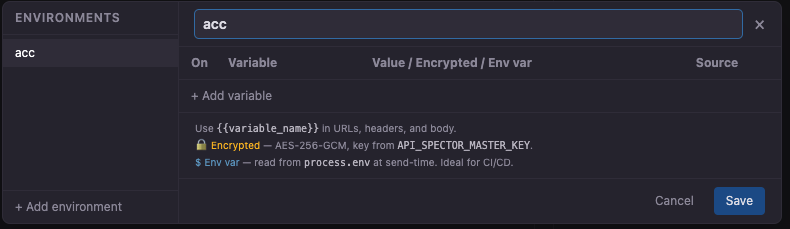
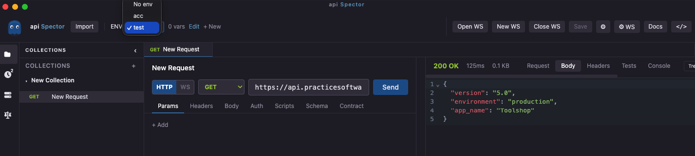
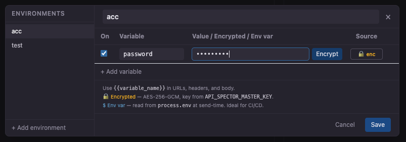
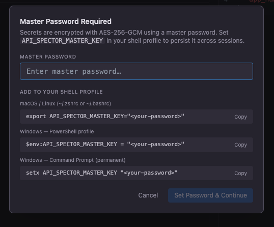

# Environments, Variables & Secrets

Environments hold key/value variables that are injected into requests at send time using `{{variableName}}` syntax.

## Create an environment

1. In the top bar, click **+ New** next to the environment selector
2. The environment editor opens automatically
3. Enter a name in the **Name** field
4. Add variables and click **Save**



Environment files are saved as `environments/<name>.env.json` relative to the workspace. Environment names must be unique within a workspace.

## Switch environments

Use the **Env** dropdown in the top bar to switch the active environment. All requests use the active environment's variables at send time.



## Environment inheritance

An environment can extend another one. Set the **Extends** dropdown in the environment editor to a parent environment: the child inherits every parent variable and overrides the ones it redefines. Chains work (`base` extended by `staging` extended by `staging-eu`), and the editor shows how many variables are inherited.

Typical use: put shared values (hosts, timeouts, common headers) in a `base` environment, and keep per-stage environments small: only the values that actually differ.

Inheritance applies everywhere the environment is used: sending requests, the collection runner, contract runs, code generation, and variable autocompletion. The CLI resolves the same chains, so `--environment staging` behaves identically in CI.

## Default environment

Workspace Settings (General tab) can name a **default environment**. Two things use it:

- CLI runs without an `--environment` flag (`api-spector run`, `api-spector contract run`) fall back to it.
- When the app opens a workspace and no environment is selected yet, it activates the default.

The environment picker marks it with "(default)". The setting is stored in the workspace file, so it travels through git with the project.

## Variable types

### Plain text

Normal key/value pairs stored as-is in the `.env.json` file.

```
BASE_URL = https://api.example.com
API_VERSION = v2
```

### OS environment reference (`envRef`)

The value is read from an OS environment variable at send time, never stored on disk. Set `envRef` to the name of an OS variable, e.g. `MY_API_TOKEN`; at send time the main process reads `process.env.MY_API_TOKEN`. This is ideal for CI/CD and for values you never want written to a file.

A `$env` value is treated like a plain variable: it is shown in full in the sent-request preview and history. It is not masked, because an OS variable is often not a secret (for example `LOGNAME`). For a value that must be masked in the preview, use the **encrypted secret** type below.

> **A desktop app only sees the environment it was launched with.** If you `export MY_API_TOKEN=...` in your shell profile and then start API Spector by double-clicking its icon (Finder, Dock, Start menu), the app does **not** inherit that variable, and the `$ Env var` reference resolves to an empty value. A GUI-launched app gets the desktop session's environment, not your interactive shell's. The same caveat applies to `API_SPECTOR_MASTER_KEY` (see [Master password](#master-password)) and to secret-manager variables such as `VAULT_ADDR` / `VAULT_TOKEN`. How to make the variable visible depends on the platform.

#### macOS

The reliable option is to **launch from a terminal** where the variable is exported, so the app inherits that terminal's environment:

```bash
export MY_API_TOKEN="your-value"      # or keep this line in ~/.zshrc
open -a "API Spector"                 # inherits this terminal's environment
```

Double-clicking the icon in Finder or the Dock will not pick up a variable from `~/.zshrc`, because those files are read by interactive shells, not by the GUI launch. (`launchctl setenv MY_API_TOKEN "your-value"` can expose a variable to the GUI session on some macOS versions, but its effect on Dock-launched apps is inconsistent across releases, so prefer launching from a terminal.)

#### Windows

Set it as a **user or system environment variable** so GUI-launched apps inherit it:

- Settings → search "Edit environment variables for your account", add it there, or
- run `setx MY_API_TOKEN "your-value"` in a terminal (persistent; applies to new processes).

Then **restart API Spector** — a running app keeps the environment it started with, and only processes started *after* the change see it. A variable set with `set` in one `cmd` window, or `$env:MY_API_TOKEN` in one PowerShell window, is visible only to apps launched from that same window, not to the icon.

#### Linux

Either **launch from a terminal** where the variable is exported (as on macOS), or set it for the whole desktop session in `~/.config/environment.d/*.conf` or `~/.profile`, then log out and back in so the session picks it up.

#### CI/CD and the CLI

Headless runs (`api-spector run`, pipeline jobs) inherit the environment of the process that starts them, so a pipeline variable or masked secret of the same name is read with no extra setup. This is the intended home for `envRef` variables.

> **Quick check:** if an `$ Env var` row resolves to an empty value, the app almost certainly did not inherit the variable. Launch it from a terminal where the variable is exported to confirm, then make the variable visible to the GUI session (above) for day-to-day use.

### Encrypted secret

The value is encrypted with AES-256-GCM using a master password. The ciphertext is stored in the `.env.json` file; the plain text value never touches disk.

To create a secret:

1. Add a variable row and enable the **Secret** toggle
2. Type the plain text value in the input field
3. Click **Encrypt**: the master password modal appears if needed
4. Enter your master password and confirm



The stored file contains only: `secretEncrypted`, `secretSalt`, `secretIv`, and a short `secretHash` (first 8 hex chars of SHA-256 of the value, for display only, not reversible).

## Auth credentials and the OS keychain

This is a separate mechanism from environment secrets above. It applies to auth on a request, folder, or collection (Bearer token, Basic password, API key, and so on), where a credential can be held in two ways:

- **In the request** (default): type the token or password directly in the auth field. It supports `{{variables}}` and is saved with the collection file. Use a `{{variable}}` that points at a secret environment variable if you do not want the raw value on disk.
- **In the OS keychain** (optional): expand "Store in OS keychain instead", paste the value, give it a key name (for example `API_TOKEN`), and click **Save**. The value is encrypted by the operating system and stored outside the collection.

The keychain uses Electron's `safeStorage`, backed by the native credential system on each platform:

| OS | Backing |
|---|---|
| macOS | Keychain |
| Windows | DPAPI (tied to the Windows user account) |
| Linux | libsecret (GNOME Keyring / KWallet), with a basic fallback |

Notes:

- It works on Windows.
- The encrypted blob lives in `secrets.json` in the app's user-data folder, not in your workspace. It is never committed to git and does not travel between machines, so re-enter the value on a new machine. It is per-machine and per-OS-user.
- The values are not readable back in the UI (a password field only ever shows dots). If you need to see or share a credential, use a `{{variable}}`, whose value is visible in the environment editor.
- The CLI cannot read the keychain (it is not an Electron process). For `api-spector run` and CI, set an environment variable whose name matches the keychain key: the CLI resolves the reference from `process.env` of the same name. For example, a Bearer token stored under key `API_TOKEN` is read from the `API_TOKEN` environment variable when running headless.

When to use which:

- **Type it in the field** for quick local work, or use a `{{variable}}` for values you keep in an environment.
- **OS keychain** for a static, long-lived token you want encrypted at rest on this one machine.

## Using variables in requests

Use double-brace syntax anywhere: URL, headers, body, query params, script values.

```
{{BASE_URL}}/{{API_VERSION}}/users
```

```json
{
  "token": "{{AUTH_TOKEN}}"
}
```

Variable resolution order (later wins):

| Scope | Description |
|---|---|
| Globals | Shared across all collections and environments |
| Collection variables | Scoped to one collection |
| Environment variables | Active environment |
| Local variables | Set by pre-request script, request-scoped only |

## Master password

Encrypted secrets require a master password to decrypt at send time.

**Option 1: Set in shell profile** (persists across sessions):

```bash
# ~/.zshrc or ~/.bashrc
export API_SPECTOR_MASTER_KEY="your-password"
```

Then launch the app or CLI **from that terminal session** so it inherits the variable. Double-clicking the app icon will not pick it up; see [the platform note above](#os-environment-reference-envref) for why, and for the Windows/macOS/Linux equivalents.

**Option 2: Enter in the app** (per session):

When you select an environment that contains secrets and the master key is not set, a prompt appears automatically. The password is stored only in memory for the lifetime of the app process.



**For CI/CD**, set the variable as a pipeline secret:

```yaml
# GitHub Actions
env:
  API_SPECTOR_MASTER_KEY: ${{ secrets.API_SPECTOR_MASTER_KEY }}
```

If the master key is not set when sending a request, a `[warn]` message appears in the **Console** tab of the response viewer for each secret that could not be decrypted.

## Collection variables

Collection variables are stored directly inside the `.spector` collection file and are scoped to that collection. They can be read and written from scripts:

```js
sp.collectionVariables.set('token', 'abc123')
```

## Globals

Global variables are stored in `globals.json` in the workspace directory and are shared across all collections. They survive app restarts and can be written from scripts:

```js
sp.globals.set('sessionId', 'xyz')
```
